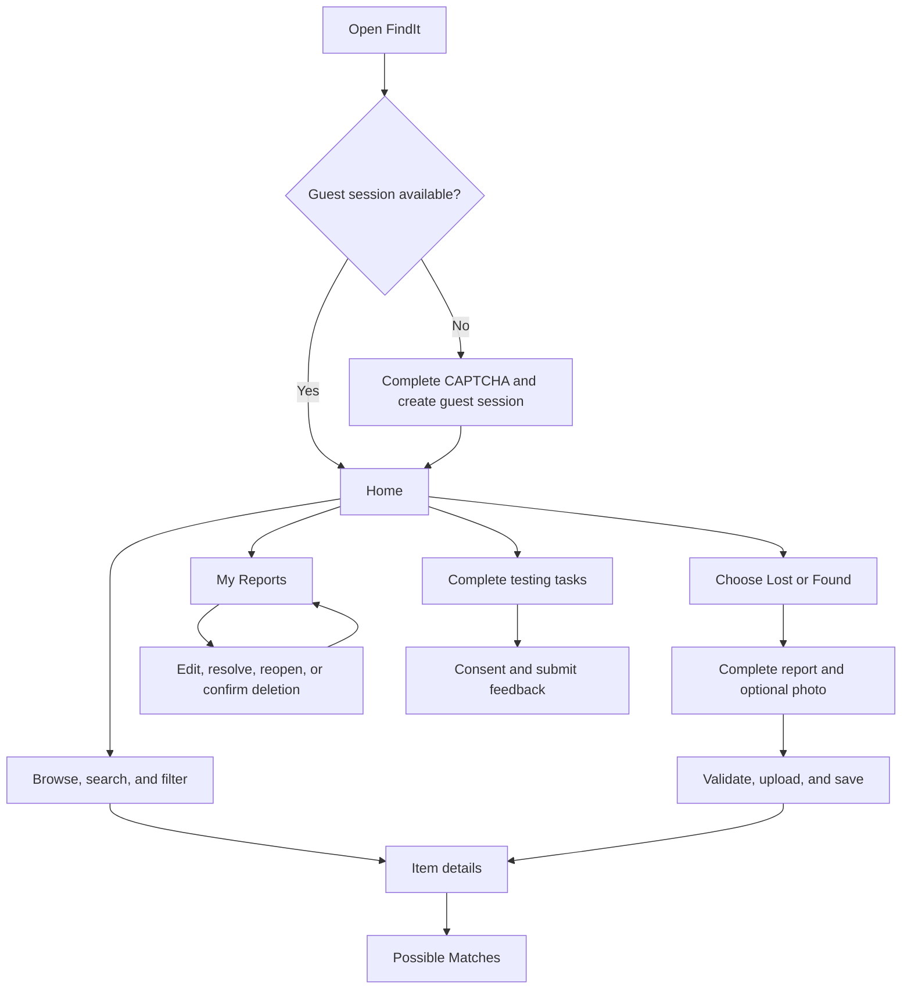

# User flow

Routes are `/`, `/browse`, `/report`, `/report/lost`, `/report/found`, `/items/[id]`, `/my-reports`, `/my-reports/[id]/edit`, `/feedback`, and `/about`.

Errors keep participants in the current flow with a reason and recovery action. A deleted item has an unavailable-report state. A syntactically invalid UUID or unknown route returns the custom 404. Another guest's report can be viewed but cannot be edited or deleted. The About page remains available before authentication.

Insert the group's actual midterm journey map here — [research artifact and source]. Document points where observed participants departed from this intended flow.
